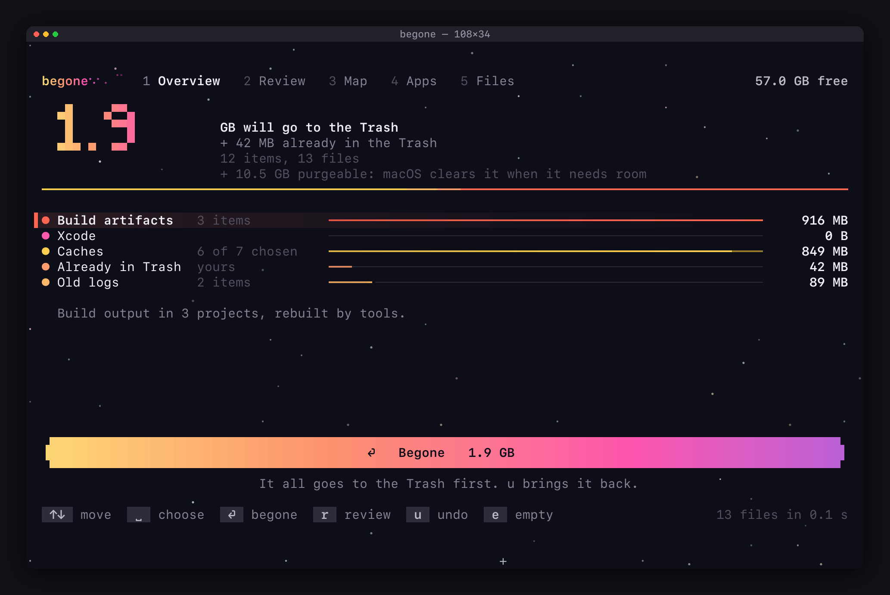
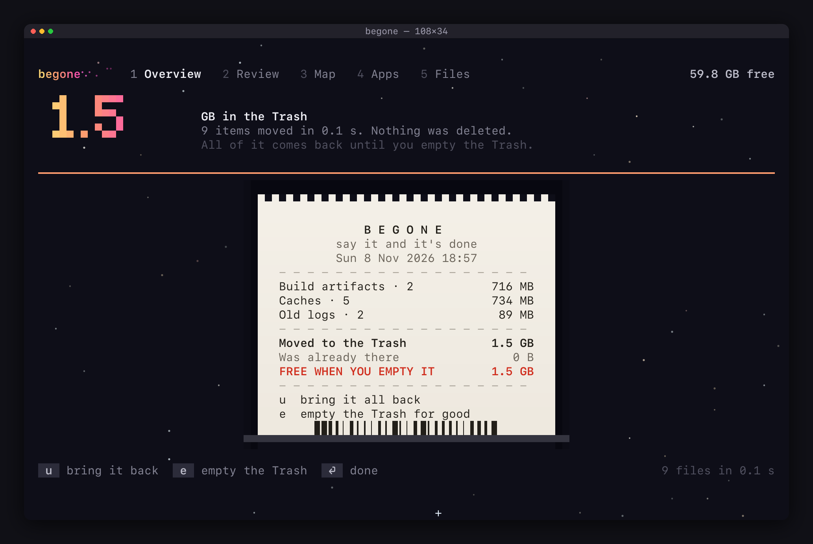
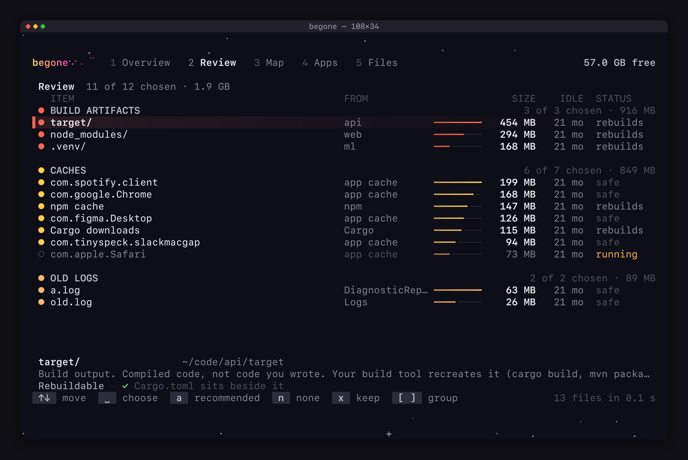
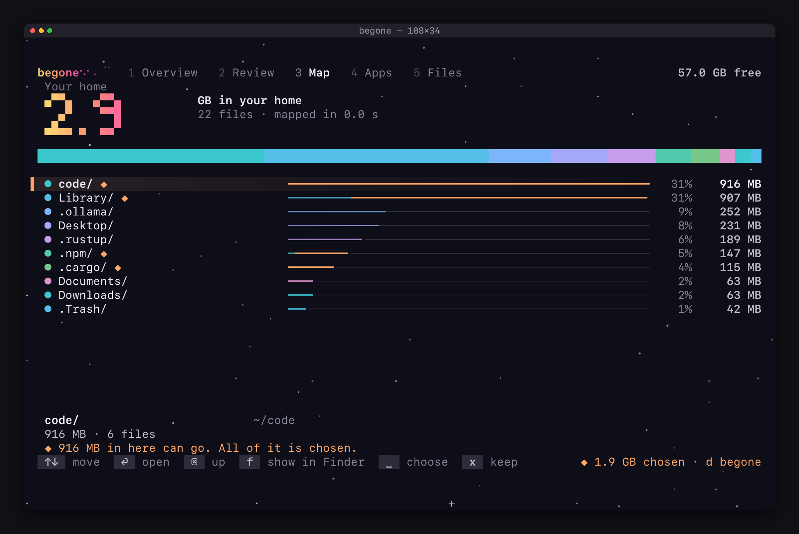
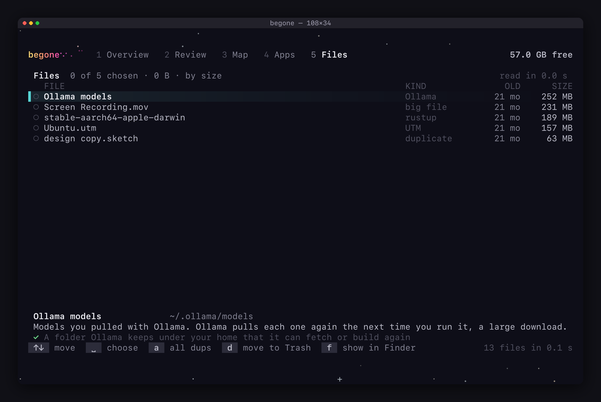

# begone

*say it and it's done.* A fast, honest, reversible disk cleaner for your Mac, in your terminal.

begone looks for things that are safe to remove, explains every one of them, and moves what you
choose to the Trash. It never deletes anything on its own, and `u` always puts the last run back.

<p align="center">
  
</p>

## Requirements

begone builds from source, so you'll need a few things first:

- **macOS** — Apple Silicon or Intel. It's developed on the latest macOS; the system features it relies on (the Trash, APFS, Spotlight) are present on **macOS 11 Big Sur and later**.
- **Xcode Command Line Tools** — for the compiler and linker. If you don't have them yet: `xcode-select --install`.
- **Rust 1.85 or newer** — begone uses the 2024 edition. Get it from [rustup.rs](https://rustup.rs); both `./install.sh` and `cargo install` use it. (No Rust on your `PATH`? `install.sh` tells you and points you there.)
- **Homebrew** — optional, only if you install via the formula.

There's no prebuilt binary yet, so building from source is the way in for now.

## Install

```bash
./install.sh               # build it and put `begone` on your PATH (re-run to update)
```

or, if you already use Rust:

```bash
cargo install --path .     # installs to ~/.cargo/bin; or just: cargo run --release
```

There's also a Homebrew formula in [`Formula/begone.rb`](Formula/begone.rb) for once it's published to a git host.

**One-time macOS permissions.** For begone to read your Trash and other protected folders, give your
terminal **Full Disk Access** (System Settings › Privacy & Security › Full Disk Access), then quit and
reopen it. To uninstall apps from `/Applications`, it also needs **App Management**, in the same place.
begone works without these — it just says when a folder is out of reach.

## What it finds

| Kind | What it is | Chosen by default |
|---|---|---|
| **Build artifacts** | `target/`, `node_modules/`, `.venv`, `.next`, `__pycache__` and friends, anywhere under your home folder. Each one is *proven* by a marker (a `Cargo.toml` beside a `target/`, a `pyvenv.cfg` inside a `.venv`), never guessed from its name. | yes, unless git does not ignore it, or something inside changed in the last week |
| **Xcode** | DerivedData, old device support (over a month), simulator caches. Never Archives, never simulator devices. | yes, unless Xcode is running |
| **Caches** | the folders in `~/Library/Caches`, and what package managers keep in your home folder: `~/.npm`, `~/.cargo`, `~/.gradle`, pnpm's store, Bun's cache, and the folders in `~/.cache`. | yes, except Apple's own, apps that are running, anything written to in the last hour, and `~/.cache` folders begone does not know |
| **Old logs** | files in `~/Library/Logs` untouched for a week. | yes |
| **The Trash** | what you already threw away. begone only *reports* it. | never moved; see below |
| **Apps** | installed apps, on their own tab (`4`), with the caches and settings they left, and what apps you already deleted left behind. | never: you choose each app yourself |
| **Files** | on their own tab (`5`): old installers (`.dmg` `.pkg` `.iso` `.xip`, over two weeks old) in Downloads; big old files (100 MB+, untouched for three months) in Downloads, on the Desktop, or loose at the top of your home folder; **developer tool stores** you can re-fetch (each Rust toolchain, each Node and Python version, the models you pulled with Ollama); **byte-for-byte duplicates**, where one copy always stays; **virtual machines and container stores** (UTM, Parallels, VMware, Docker, OrbStack); and iPhone and iPad backups. | never: you choose each one yourself |

**Package-manager caches** are on an exact list (`TOOL_CACHES` in `src/safety.rs`), and the gate admits those folders and
nothing beside them: `~/.cargo/bin`, `credentials.toml`, `~/.npmrc` and your Gradle settings are never offered. Each row says
whether getting it back costs a download. A tool that is writing to its cache right now leaves it unchecked. Folders in
`~/.cache` are caches by convention, so each is offered, and only the ones begone knows by name are chosen for you.

**Developer tool stores** (`DEV_STORES` in `src/safety.rs`) are the bigger things a tool keeps that it can fetch or build
again but that you chose to install — each toolchain under `~/.rustup/toolchains`, each Node version under `~/.nvm`, each
Python under `~/.pyenv`, and the models under `~/.ollama/models`. They are listed on the Files tab, one at a time, never
chosen for you, and the gate admits only those exact places — never the tool's own folder, a neighbour, or anything inside
your Library.

**Duplicates** are files that are byte-for-byte identical. begone groups them, keeps one copy — the one in the most deliberate
place (your Documents over the Desktop over Downloads), oldest among equals — and offers only the others. The copy it keeps is
never a row, and at the moment a copy moves the gate re-reads both files and refuses unless an identical original is still
there, so the finder can never take the last copy of anything. It compares actual bytes, never a hash, and only files that
share a size are ever read, so a full disk stays responsive.

Sizes are what removing something would really free: hard links count only when every name is inside
the thing being removed (so a pnpm `node_modules` shows its true cost), and APFS clones count once.

## Screens

**The receipt** — every run prints one: what moved, how much you'll free, and the reminder that `u` brings it all back. Nothing is gone until you empty the Trash.



**Review** — every item, grouped by kind, with where it's from, how long it's sat idle, and why it's safe. A running app's cache is left unchecked.



**Map** — a read-only, walkable map of where your space actually went. Amber marks what begone can clean; `f` reveals anything in Finder.



**Files** — the things you choose one at a time: big old files, duplicates (an identical copy always stays), developer tool stores, virtual machines, iPhone backups. `s` sorts, `a` picks every duplicate at once.



## How it keeps you safe

1. **One gate, asked twice.** A row is checked by the same safety layer when it is found and again
   immediately before it moves, so a row that could never be removed is never shown, and a folder that
   changed since the scan is refused instead of trusted.
2. **A short allowlist and a never-delete list.** Documents, Desktop, Pictures, Movies, Music, keychains,
   SSH and GPG keys, iCloud Drive, app data, Mail, Messages, Safari and Photos are protected by name,
   and the list beats the allowlist. Symlinks are never followed.
3. **The Trash, never `rm`.** Everything goes through the same call Finder uses, and the undo history is
   written *before* each move. If it cannot be written, nothing moves.
4. **Undo.** `u` restores the newest run, then the one before it, and `U` lists every run so you can put back
   any one of them (see *History* below). It refuses to overwrite anything that has come back since.
5. **Emptying the Trash is separate** (`e`), blunt, and irreversible. It touches only what is directly inside
   `~/.Trash`, and when that holds things of yours as well as things begone moved, it offers to empty only
   what begone moved (see *Emptying the Trash* below). The one other step that cannot be undone is deleting
   Xcode simulators, which is asked about on its own (see *Files*).
6. **Apps get their own, narrower gates.** `/Applications` is system territory for everything else, so an
   app is admitted only as a direct child `.app` of an Applications folder whose own `Info.plist` names a
   non-Apple bundle identifier (Xcode alone is excepted, as the bundle and nothing else), and its traces only
   by that exact identifier (see *Apps* below).
7. **Keep this.** Press `x` on a row and that place is never offered or moved again: not as a row, not inside a
   bigger row, not as the bigger row that holds it. It is enforced where things move, not just hidden on the
   screen (see *Keeping things* below).
8. **Files you choose yourself get narrow gates too.** An installer is admitted only as a regular file with an
   installer extension directly inside the real Downloads folder; a big old file only as a finished file of at
   least 100 MB that has neither arrived nor changed for three months, directly in Downloads, on the Desktop, or
   loose at the top of your home folder — never inside your document, photo, music or movie libraries, which are
   kept whole — checked again at the moment it moves; a device backup only as a direct child of a known backup
   folder (Finder's own, and the third-party tools that use the same format) that still holds a device's
   `Info.plist`; a developer tool store only at its exact place on the `DEV_STORES` list; and a duplicate only
   while an identical original is still there to compare against, re-read byte for byte before it moves. Each is
   listed one at a time and never chosen for you (see *Files* below).

## Keys

| | |
|---|---|
| `↑↓` `j` `k` | move |
| `space` | choose or unchoose (on Overview: what begone recommends for that kind) |
| `a` / `n` | choose everything recommended / nothing |
| `x` | keep the row you are on for good (on Review, the Map, Apps or Files); `x` again lets it go |
| `t` | free up a size: type how much you want, and the safest recommended rows are chosen until it is reached |
| `enter` `d` | begone: move what is chosen to the Trash (you confirm first). On the Map, `enter` opens a folder |
| `u` `U` | undo the last run; `U` lists every run and puts back the one you pick |
| `e` | empty the Trash for good (or, when it also holds things of yours, only what begone moved) |
| `1` `2` `3` `4` `5` | jump to Overview, Review, the Map, Apps or Files, from anywhere (`o` `r` `m` do the same for the first three, and `m` on the Map maps again) |
| `tab` `shift+tab` | next tab, previous tab |
| `[` `]` | jump between groups in Review |
| `backspace` `esc` | on the Map: up one folder (`esc` at the top leaves the Map) |
| `f` | on the Map, Review, Apps or Files: show the selected row in Finder |
| `s` | on Apps and Files: change the order — by size, by name, or by date (oldest first) |
| `a` | on Files: choose every duplicate at once (safe — an identical copy stays for each) |
| `space` `d` `n` | on Apps and Files: choose a row, move the chosen rows to the Trash (you confirm first), clear the choice |
| `q` | quit |

The Apps and Files lists come **biggest first**. `s` cycles the order through **size**, **name** (A→Z) and **date** (oldest
first, the stalest things at the top), and the header says which you are in. The cleaning panel and the Map stay ordered by
size, because there the point is where the space is.

## Options

```
begone --path DIR          pretend DIR is your home; its Trash is a folder inside it, so nothing real is touched
begone --volume DIR        scan and clean an external or secondary volume (e.g. /Volumes/MyDrive)
begone --no-splash         skip the launch splash
begone --no-stars          a plain dark background (or set BEGONE_NO_STARS=1)
```

`BEGONE_COLOR=truecolor|256|none` overrides colour detection, and `NO_COLOR` is honoured.

## External and secondary drives

`begone --volume /Volumes/MyDrive` points begone at a drive instead of your home folder. What you remove goes to a Trash
**on that same volume** (`.Trash` at its root), so `u` still undoes it and nothing is ever `rm`'d. The finds that make sense on
a drive are the ones that are not about a home folder: the **map** of where its space went, **big old files**, **duplicates**
anywhere on it, and **build output** from projects you keep there. The home-only finds (app caches, Xcode, iPhone backups and
the rest) simply find nothing. The safety is unchanged and, if anything, tighter: only the one volume you name is operable —
every *other* volume, and all of `/System`, `/usr`, `/Applications` and the rest, stay off limits exactly as always.

## Tuning

The size and age cutoffs are built in, but you can change them in an optional file at `~/.config/begone/config.txt`
(one `key = value` per line, `#` for comments). Everything is optional; an unknown key or a bad value just leaves the default.
It only changes the cutoffs of the finds begone already has — it can never make it offer new *kinds* of things.

```
big-file-size      = 100MB   # how big a file must be to be a "big old file"
big-file-age       = 90d     # and how long untouched (d, h, w, or a bare number of days)
duplicate-min-size = 1MB     # the smallest file the duplicate finder compares
app-leftover-min   = 1MB     # how much a deleted app must have left to be worth a row
simulator-min      = 50MB    # below this is the empty simulator Xcode makes itself
```

## Terminals

There is one screen, at every size from 60×22 up, drawn in text cells: a big number, a bar for each kind, a button and
the keys. A window bigger than 140×30 keeps the screen at that size, in the middle, with the sky around it, so a row never ends up
a hundred cells from its size and the button stays beside the list. Any truecolor terminal gets the colours; 256-colour terminals such as Terminal.app get the same screen with a
mapped palette, and `NO_COLOR` gets it with none. Below 60×22 begone says how much room it needs. In Review, the line under
the list says what the selected item is, what happens if it goes, and the evidence that it is safe.

## Apps

`4` opens the Apps tab: every third-party app in `/Applications` and `~/Applications`, biggest first, with what each
left behind. `space` chooses an app, `d` (or `enter`) asks whether to uninstall the chosen ones, and `y` moves them
to the Trash. It is the same move as everything else: it plays out on the Overview, ends in a receipt, and `u` puts
the apps back exactly as they were. Nothing is chosen for you, and `a` on this tab does nothing.

What goes with an app is only what can be *proven* to be its own: the bundle, and the caches, settings, saved state
and web storage named by its exact bundle identifier (`~/Library/Caches/com.vendor.App`, `Preferences/com.vendor.App.plist`,
and so on). The list is made by the same gate that admits each item again at the moment it moves, so nothing is shown
that could not be removed.

What stays: the folders that may hold your own documents (`Containers`, `Application Support`) are listed with their
sizes under the app, and never removed. Neither are system-wide files in `/Library`, login items or launch agents.
An app that is running is refused (quit it, then choose it), and an app's settings only go once nothing installed
still carries its identifier, so an app that fails to move keeps its settings. Only apps directly inside an
Applications folder are listed, because those are the ones that can be removed. Two apps that share a name (two
Xcodes) are listed by their folder names, `Xcode` and `Xcode-15.4`, and "running" is judged per copy, so an old
Xcode can go while the new one is open.

**Apple's own apps are never offered, except Xcode.** It is the one that takes tens of gigabytes, and the App Store or
developer.apple.com brings it back. It is offered as the app alone: its caches and settings are shared with macOS's
developer tools, so they stay, and so does `~/Library/Developer` (DerivedData, Archives, simulators; the Overview offers
the DerivedData). If `xcode-select` points into the Xcode you are removing, the question says that git, clang and the other
command line tools stop working until you run `sudo xcode-select --reset`. The exception is one identifier
(`REMOVABLE_APPLE_APPS` in `src/safety.rs`), and anything macOS protects (System Integrity Protection) is refused
whoever made it.

macOS may refuse to let your terminal remove apps unless it has App Management permission (System Settings, Privacy
& Security). If so, begone says so, and nothing is touched. With `--path DIR`, the apps are the ones in `DIR/Applications`,
so you can try it without going near the real ones.

### What apps you deleted left behind

The Apps list also shows apps that are **no longer installed**, by their identifier (`com.vendor.App`), marked `gone`, when
they left something behind. It is the same gate and the same rule as for an app: only caches, settings, saved state and web
storage named by that exact identifier, never `Containers` or `Application Support`, which are listed under it as data that
stays. An identifier is taken for a leftover only when no installed app carries it, no helper or part of an installed app has
a name that starts with it (or it with theirs), nothing running uses it, and, on your real machine, Spotlight knows of no app
with it anywhere (and answers for one that is certainly there, or nothing is offered). Anything under 1 MB is left out, and
one that changed in the last month says so, because an app begone cannot see may still be using it. At the moment it moves,
the run proves again that the app has not been installed or opened since.

## Files

`5` opens the Files tab, biggest first, each row saying what it is and how old it is. None of this is junk begone can prove, so
nothing is chosen for you: `space` chooses, `d` asks, and `y` moves them to the Trash like everything else — one receipt, `u` puts
them back. It holds:

- **old installers** (`.dmg`, `.pkg`, `.mpkg`, `.iso`, `.xip`) that sit directly in Downloads and are over two weeks old;
- **big old files** — any finished file of at least 100 MB that has neither arrived nor changed for three months, directly in
  Downloads, on the Desktop, or loose at the top of your home folder (and, on your real machine, that Spotlight has not seen
  opened in that time). Your document, photo, music and movie libraries are kept whole and never scanned this way — walk the
  map to reach them;
- **developer tool stores** you can re-fetch but chose to install: each Rust toolchain (`~/.rustup/toolchains`), each Node
  version (`~/.nvm`), each Python (`~/.pyenv`), and the models you pulled with Ollama (`~/.ollama/models`). The gate admits only
  those exact places (`DEV_STORES` in `src/safety.rs`), never a tool's own folder or anything in your Library;
- **duplicates** — files that are byte-for-byte identical. begone keeps one copy, the one in the most deliberate place and oldest
  among equals, and offers only the others; the kept copy is never a row. At the moment a copy moves the gate re-reads both
  files and refuses unless the identical original is still there, so it can never take the last copy. It compares real bytes,
  not a hash, and reads only files that share a size. `a` chooses every duplicate at once;
- **virtual machines and container stores** — UTM, Parallels and VMware VMs, and Docker's or OrbStack's data, each at the exact
  place its app keeps it (`VM_STORES` in `src/safety.rs`). These are often the single biggest thing on a developer's Mac, and
  usually the only copy of what is inside, so they are listed with a strong warning, never chosen, and the question says so;
- **iPhone and iPad backups** — the folders in `~/Library/Application Support/MobileSync/Backup`, and the third-party backup
  tools that keep the same format in their own place, recognised by the device `Info.plist` at the top, never by the folder's
  name. A backup may be the only copy of what was on a device you no longer have, so it says so, in amber, in the question;
- **Xcode simulators** (see below).

Backups need Full Disk Access for your terminal; if they cannot be read, the tab says so.

**Xcode simulators and their runtimes** are listed from Xcode's own tool, `simctl`, with their size and when they were last used (a
simulator under 50 MB is the empty one Xcode makes for itself, and is left out). begone never touches their folders: Xcode keeps its
lists right only when `simctl` deletes them, and what `simctl` deletes does not go to the Trash. So this is the one choice here that
cannot be undone, and it is treated like emptying the Trash: the row says `simulator` in amber, the key says `d  delete for good`,
the question is in red and says they cannot be brought back, and it is never combined with files that can be put back. A simulator that
is running cannot be chosen, `simctl` is only ever given a UUID, and the history records what was deleted. On a scratch home
(`--path`) the real Xcode is never asked; `BEGONE_SIMCTL=/path/to/program` names a stand-in that answers as `xcrun` does, to try the
screens with.

## Emptying the Trash

`e` asks first, and says how much of the Trash is begone's. When the Trash holds more than that, the question offers three things:
`b` empties **only what begone moved**, `y` empties everything (yours too), `n` keeps it. begone knows what it moved by the file
itself, not by its name: the history remembers each item's device and inode, a move is a rename that keeps them, and an entry in the
Trash is begone's only if it is that very file. A file of yours that was given the same name after Finder emptied begone's is not
taken, and neither is anything moved before this was recorded. It is proved again, entry by entry, at the moment of removal.

## History

`U` lists every run, newest first: when, how many items and how much, and how it stands now (`in the Trash`, `2 of 5 left`, `put
back`, `emptied`), with the kinds it moved on the line below. Emptyings of the Trash and deleted simulators are in it too, marked `no
undo`. `u` (or enter) puts back the run under the cursor, whichever it is, without undoing the newer ones first. Out of order, an item
whose folder is no longer there is refused instead of making the folder again, because a newer run may be what removed it.

## Free space

The figure in the header is the volume's raw free space. Finder's "available" also counts **purgeable** space (local snapshots and
caches macOS clears by itself when it needs room), so freeing 10 GB can move the number less than you expect. When there is at least half
a gigabyte of it, the Overview says so under the headline: `+ 7.9 GB purgeable: macOS clears it when it needs room`.

## Keeping things

`x` keeps the row you are on for good. A kept row stays in its list, dimmed, marked `◇` and `kept`; it is not counted, never
chosen (not by `a`, not by the goal, not by space), and the engine refuses to move it even if something asked. Keeping a folder
keeps everything inside it, and a place that holds a kept place cannot move either. The list is a plain text file you can read and
edit, `~/.config/begone/keep.txt`, one place per line (`~/code/app/node_modules`); with `--path DIR` it is `DIR/.config/begone/`.

## Freeing a size

`t` asks "Free up how much?". Type a size (`20`, `20 GB`, `500 MB`, `1.5 TB`; a bare number is gigabytes) and begone chooses rows
for you: only ones it recommends, never a kept one, safest first, and where one row covers what is still needed it takes the
smallest such row rather than several. Nothing moves until you press `d`; the choice can be changed row by row like any other. If
everything recommended is less than you asked for, it chooses all of it and says how far short it is.

## The map

`m` (or `tab`) opens the Map: where the bytes in your home folder live, one folder at a time. A strip across the top shows how
the folder is made up, and the list under it runs biggest first with each row's share and size. `enter` opens a folder,
`backspace` goes back up, and `f` shows the selected row in Finder.

Whatever begone found that it could clean is marked with an amber `◆`, and the end of that row's bar is amber too, so the map and
the cleaning are one picture. `space` on a marked row chooses or unchooses exactly what begone found there. It never chooses
anything else, because begone only moves what it can prove is safe. The lines under the list say what is selected, where it is,
and how much of it can go.

The map only reads. It lists folders and reads sizes, never opens a file, never follows a symlink, and stays on the disk it
started on, so a mounted volume or a cloud folder inside your home is not counted. Sizes follow the same rules as everywhere
else: allocated blocks, a hard link once, an APFS clone's shared data once. The walk is folded into a small tree as it goes (the
48 biggest things in each folder, and one "smaller items" row for the rest). At the top of your real home, one dim row,
"Everything else on this disk", holds apps, macOS and other people's files, so the rows add up to what the disk says is used.
Folders macOS keeps private count as not readable until your terminal has Full Disk Access, and the top of the map says how many.

## The receipt

When a run finishes, a paper receipt prints up out of a slot at the bottom of the screen, a line at a time: what moved, what the Trash
holds now, what was left alone, and how to bring it back. The line beside the big number says how many items moved, how long it took, and
that nothing was deleted. `enter`, `esc` or `space` puts the paper away. It is cream paper with dark ink, drawn in cells; with `NO_COLOR` it
is a ticket drawn with box characters, with the same words. A short window gets a shorter paper, with the least important lines
dropped first, so the totals are always on it.

## The launch

The name gathers out of drifting dust, holds for a moment and blows away, and the app condenses out of the same dust. It takes
1.6 seconds, any key skips it, and `--no-splash` leaves it out. The lettering, the dust and the stars are braille dots, eight to
a cell, which is far finer than block characters, so it looks the same in any truecolor terminal. `--no-stars` also clears
the dusty sky behind it.

## The sky

Behind everything there is a night sky: two layers of stars that drift past at different speeds. They are the
characters `·` `∙` `+` `*`, placed only on empty dark cells with no text within two cells, so one is never mistaken for
punctuation, and held back further where the screen is full of things to read. The sky moves while begone is working
and rests when it is not, so a screen left open costs nothing. It is never drawn with `NO_COLOR`.

The first run may make macOS ask whether your terminal can open Desktop or Documents: begone looks there only for
build folders, and never opens a file's contents.

The Trash row says "can't read" until you give your terminal **Full Disk Access** (System Settings →
Privacy & Security), because macOS protects `~/.Trash`.

## Developing

```bash
cargo test                       # unit tests, hermetic: a scratch Trash, never yours
cargo clippy --all-targets
```

Every screen is a pure function of state, so any frame can be rendered headlessly from real data:

```bash
begone --path ~/some/fake/home --dev-snap out.txt --dev-size 140x44 \
       --dev-script "wait:3 snap key:d wait:0.4 snap key:y wait:1.5 snap"
```

Steps are `wait:SECS`, `key:NAME`, `snap` and `splash`. Set `BEGONE_DEV_ASPECT=2.77` to draw with the cell shape of a
real terminal with a generous line height (the default is 2.0).

## Layout

```
src/safety.rs    the gate: allowlist, never-delete list, proofs for build output
src/sizing.rs    what removing a path would really free
src/scan/        scanners: they only discover; the engine checks and measures
src/engine.rs    scan, move, undo, empty: the only code that changes your disk
src/journal.rs   the append-only undo history
src/map.rs       the disk map: a read-only walk, folded into a small tree
src/apps.rs      installed apps, what each left behind, and what apps that are gone left; read-only; the gates that admit them are in `safety.rs`
src/files.rs     old installers, big old downloads, device backups and simulators, read-only
src/simulators.rs  Xcode's simulators through `simctl`: listing, and the one deletion that does not go to the Trash
src/keep.rs      the list of places you keep, and its file
src/app.rs       state and keys, with no terminal in it
src/ui/          the screen, drawn in cells (`compact.rs` is the screen, `review.rs` its list, `map.rs` the Map tab, `apps.rs` the Apps tab, `files.rs` the Files tab, `sky.rs` the
                 starfield, `dots.rs` the braille canvas, `boot.rs` the launch)
src/term.rs      colour depth detection and the 256-colour and no-colour mappings
```

MIT licensed.
